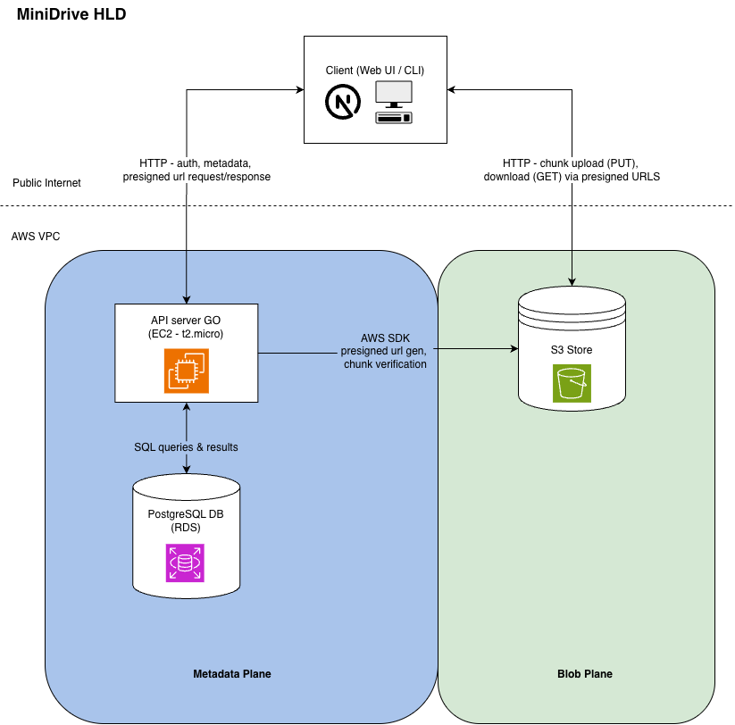

# MiniDrive

A cloud file storage service where users upload, organize, sync, and share files across devices — built from scratch as a system design exercise.

## What is this?

A personal Google Drive clone. The goal is to learn and demonstrate core distributed-systems design by building a real, working product: chunked resumable uploads, folder hierarchy, sharing with ACLs, versioning, and multi-device sync.

This is not a market product. The value is in understanding every layer end to end — enough to whiteboard the full system from memory in a design interview.

## Architecture

Two-plane design:
- **Metadata Plane** (API + PostgreSQL) — handles auth, file tree, permissions, versioning, and sync. Strong consistency.
- **Blob Plane** (S3) — stores file chunks. Clients upload/download directly via presigned URLs. The API never proxies file bytes.

## Database Schema

8 tables across 5 domains: auth (users, refresh_tokens), file tree (nodes, versions), blob (chunks, version_chunks), sharing (shares), and sync (change_log).

## Tech Stack

See [docs/tech-stack.md](docs/tech-stack.md) for full details and reasoning.

| Component    | Choice                         |
| ------------ | ------------------------------ |
| Backend API  | Go (stdlib `net/http`)         |
| CLI Client   | Go                             |
| Web UI       | Next.js (later phase)          |
| Database     | PostgreSQL (RDS)               |
| Blob Storage | S3 (MinIO locally)             |
| Compute      | EC2 t2.micro (free tier)       |
| Auth         | DIY JWT (bcrypt + short-lived) |

## Design Documents

All design docs live in [`design/v1/`](design/v1/).

| Doc | What it covers |
| --- | --- |
| [HLD Document](design/v1/Task2HLDdoc.md) | Consistency model, failure modes, capacity estimates (100M users), scaling strategy, trade-offs |
| [API Spec](design/v1/Task3APISpec.md) | Every endpoint — request/response shapes, error codes, auth, rate limiting |
| [Database Schema](design/v1/Task4DatabaseSchema.md) | All tables with SQL, indexes, constraints, and design decisions |
| [Auth Flow](design/v1/Task5AuthFlow.md) | Signup, login, JWT structure, refresh, middleware chain, security |
| [Sharing & ACL](design/v1/Task6SharingACL.md) | Roles, inheritance, permission resolution, grant/revoke flows, scaling |
| [Sequence Diagrams](design/v1/Task8SequenceDiagrams.drawio) | Auth, chunked upload, download, sync polling, share grant/revoke |
| [Class Diagram](design/v1/Task10ClassDiagram.drawio) | Go packages, structs, interfaces, dependencies |
| [Real-World Q&A](RealWorldQuestions.md) | Interview-style follow-ups on every design decision |

## Status

🚧 Phase 0 — Design (tasks 1–10 complete, protocols & project setup remaining)
