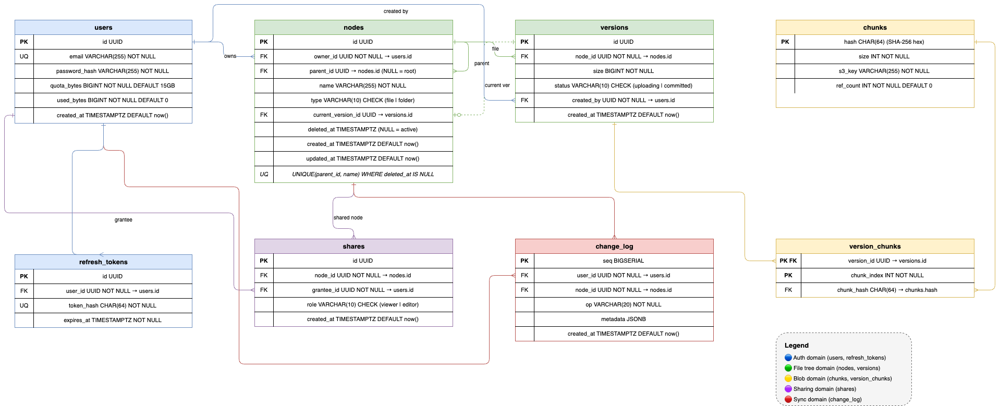

# MiniDrive

A cloud file storage service where users upload, organize, sync, and share files across devices — built from scratch as a system design exercise.

## What is this?

A personal Google Drive clone. The goal is to learn and demonstrate core distributed-systems design by building a real, working product: chunked resumable uploads, folder hierarchy, sharing with ACLs, versioning, and multi-device sync.

This is not a market product. The value is in understanding every layer end to end — enough to whiteboard the full system from memory in a design interview.

## Architecture

Two-plane design:
- **Metadata Plane** (API + PostgreSQL) — handles auth, file tree, permissions, versioning, and sync. Strong consistency.
- **Blob Plane** (S3) — stores file chunks. Clients upload/download directly via presigned URLs. The API never proxies file bytes.


## Key Flows

- **Upload**: client chunks file (4 MB, SHA-256) → API returns presigned PUT URLs → client uploads directly to S3 → API verifies and commits to Postgres
- **Download**: API returns presigned GET URLs → client downloads chunks from S3 → verifies hashes → reassembles
- **Sync**: cursor-based polling (`GET /changes?cursor=N`) every 10 seconds. Conflict resolution via "conflicted copy" files.

Detailed sequence diagrams: [Auth](design/v1/Task8Seq_Auth.md) · [Upload](design/v1/Task8Seq_Upload.md) · [Download](design/v1/Task8Seq_Download.md) · [Sync](design/v1/Task8Seq_SyncPolling.md) · [Sharing](design/v1/Task8Seq_Sharing.md)

## Database Schema

8 tables across 5 domains: auth (users, refresh_tokens), file tree (nodes, versions), blob (chunks, version_chunks), sharing (shares), and sync (change_log).



## Tech Stack

See [docs/tech-stack.md](docs/tech-stack.md) for full details and reasoning.

| Component    | Choice                         |
| ------------ | ------------------------------ |
| Backend API  | Go (stdlib `net/http`)         |
| CLI Client   | Go                             |
| Web UI       | Next.js (later phase)          |
| Database     | PostgreSQL (RDS)               |
| Blob Storage | S3 (MinIO locally)             |
| Compute      | EC2 t2.micro (free tier)       |
| Auth         | DIY JWT (bcrypt + short-lived) |

## Project Structure

```
miniDrive/
├── cmd/server/          # API server entry point
├── cmd/cli/             # CLI client (cobra)
├── internal/
│   ├── auth/            # JWT, password hashing, middleware
│   ├── handler/         # HTTP handlers + routes
│   ├── storage/         # Postgres queries (pgx)
│   ├── s3client/        # S3/MinIO presigned URLs
│   ├── acl/             # Permission resolution
│   ├── model/           # Shared structs
│   ├── config/          # Env-based config
│   └── cleanup/         # Orphan chunk cleanup job
├── migrations/          # SQL migrations (goose)
├── scripts/             # Seed data, DB reset
├── docker-compose.yml   # Postgres + MinIO
└── Makefile             # Build, run, test, migrate
```

See [Task 13](design/v1/Task13ProjectStructure.md) for full details and [class diagram](design/v1/Task10ClassDiagram.md) for package dependencies.

## Local Dev

```bash
cp .env.example .env
docker compose up -d
goose -dir migrations postgres "$DATABASE_URL" up
go run ./cmd/server
```

See [Task 14](design/v1/Task14LocalDevSetup.md) for full setup guide, docker-compose config, seed data, and testing strategy.

## Design Documents

All design docs live in [`design/v1/`](design/v1/).

### High-Level Design

| Doc | What it covers |
| --- | --- |
| [HLD Document](design/v1/Task2HLDdoc.md) | Consistency model, failure modes, capacity estimates (100M users), scaling strategy, trade-offs |

### Low-Level Design

| Doc | What it covers |
| --- | --- |
| [API Spec](design/v1/Task3APISpec.md) | Every endpoint — request/response shapes, error codes, auth, rate limiting |
| [Database Schema](design/v1/Task4DatabaseSchema.md) | All tables with SQL, indexes, constraints, and design decisions |
| [Auth Flow](design/v1/Task5AuthFlow.md) | Signup, login, JWT structure, refresh, middleware chain, security |
| [Sharing & ACL](design/v1/Task6SharingACL.md) | Roles, inheritance, permission resolution, grant/revoke flows, scaling |

### Diagrams

| Doc | What it covers |
| --- | --- |
| [Architecture Diagram](design/v1/Task1HLDArchitecture.drawio) | Component diagram with network zones |
| [ER Diagram](design/v1/Task4DatabaseSchema.drawio) | All 8 tables, columns, relationships |
| [Class Diagram](design/v1/Task10ClassDiagram.md) | Go packages, structs, interfaces, dependencies (Mermaid) |
| Sequence Diagrams | [Auth](design/v1/Task8Seq_Auth.md) · [Upload](design/v1/Task8Seq_Upload.md) · [Download](design/v1/Task8Seq_Download.md) · [Sync](design/v1/Task8Seq_SyncPolling.md) · [Sharing](design/v1/Task8Seq_Sharing.md) |

### Protocols & Flows

| Doc | What it covers |
| --- | --- |
| [Upload/Download Flow](design/v1/Task11UploadDownloadFlow.md) | Chunking, presigned URLs, parallel transfer, resume, dedup, error handling |
| [Sync Protocol](design/v1/Task12SyncProtocol.md) | Cursor-based change feed, conflict detection, conflicted copies, offline behavior, multi-device sync |

### Project Setup

| Doc | What it covers |
| --- | --- |
| [Project Structure](design/v1/Task13ProjectStructure.md) | Go module layout, package responsibilities, dependency graph, Makefile |
| [Local Dev Setup](design/v1/Task14LocalDevSetup.md) | Docker Compose, env config, migrations, seed data, dev workflow, testing |

### Interview Prep

| Doc | What it covers |
| --- | --- |
| [Real-World Q&A](RealWorldQuestions.md) | 40+ interview-style follow-ups across all design decisions |

## Status

✅ Phase 0 — Design complete (all 14 tasks)
🚧 Phase 1 — Implementation starting
